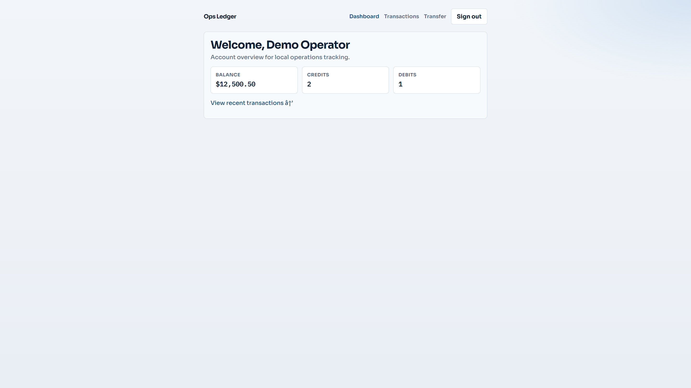

# Ops Ledger

A compact operations ledger web app inspired by multi-page banking demos:

- hash routing (`login`, `dashboard`, `transactions`, `transfer`)
- form handling and validation messages
- persistent local state (`localStorage`)
- transaction filters and ledger summaries

## Status

Browser demo with store helpers, filters, unit tests, and CI. No CLI or server.

Demo credentials: `demo` / `ledger123`

## Screenshot



## Run

```powershell
python -m http.server 5190
```

Then open http://localhost:5190

Demo state persists in `localStorage` under the key `ops-ledger-v1` (clear it to reset).

## Test

```powershell
node --check js/store.js
node --check js/app.js
node --test test/store.test.mjs
```

## Module

```js
import {
  loadState,
  login,
  postTransaction,
  filterTransactions,
  summarizeTransactions,
  transfer,
  currentUser,
} from "./js/store.js";

const state = loadState();
login(state, "demo", "ledger123");
postTransaction(state, { amount: 50, label: "Adjustment" });
const rows = filterTransactions(currentUser(state).transactions, {
  type: "credit",
  query: "adjust",
});
const summary = summarizeTransactions(rows);
```

## License

MIT
