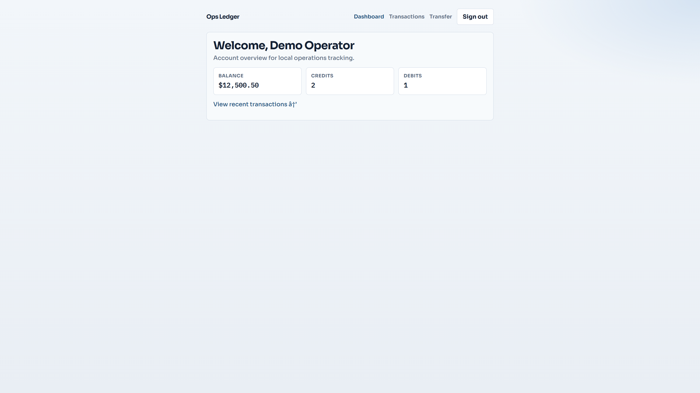

# Ops Ledger

A compact operations ledger web app inspired by multi-page banking demos:

- hash routing (`login`, `dashboard`, `transactions`, `transfer`)
- form handling and validation messages
- persistent local state (`localStorage`)

## Status

Complete: state helpers, accessible demo page, styles, and CI.

Demo credentials: `demo` / `ledger123`


## Screenshot



## Run

```powershell
python -m http.server 5190
```

Then open http://localhost:5190

Demo credentials: `demo` / `ledger123`


Demo state persists in `localStorage` under the key `ops-ledger-v1` (clear it to reset).

## Module

```js
import { loadState, login, transfer, currentUser } from "./js/store.js";

const state = loadState();
login(state, "demo", "ledger123");
```

## License

MIT
